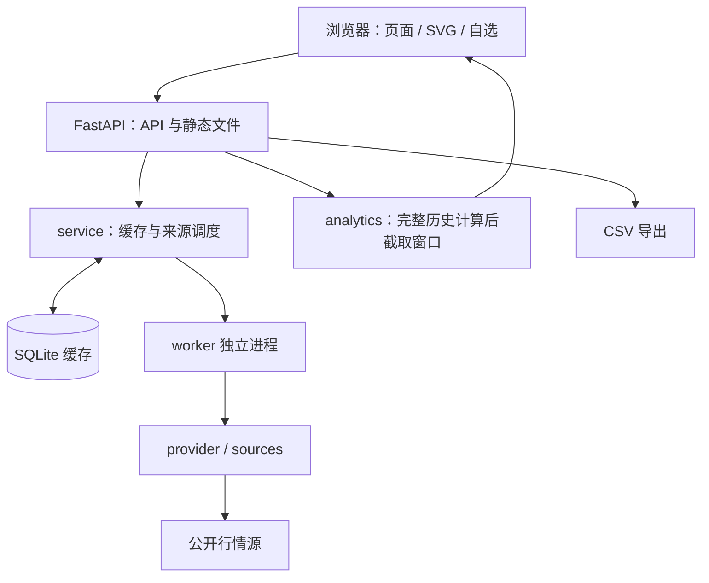

# 架构与开发说明

更新日期：2026-11-24。本文描述当前实现；未完成事项见 [开发记录](development-log.md)。

## 1. 设计目标与技术选择

观市为个人 A 股基金投资者集中展示行情、资金和历史趋势，采用前端 + 后端架构。当前以本机单用户使用为目标，提供可核对的数据日期、来源与统计，不自动生成交易指令。

后端为 Python + FastAPI，使用 Uvicorn 运行；前端为原生 JavaScript 模块、CSS、HTML 与交互 SVG，无 Node 构建步骤。前端与 API 由同一服务提供。SQLite 保存公开源缓存，浏览器 localStorage 保存自选与模式设置。

Python 要求为 3.11 或以上，当前实际验证为 3.13。主要依赖为 FastAPI、Uvicorn、AKShare、HTTPX；pytest 用于测试。直接依赖见 `requirements.txt`，完整安装版本快照见 `requirements.lock.txt`。Docker 使用 Python 3.13，当前仍按 requirements.txt 安装。

## 2. 结构与职责

| 文件 / 目录 | 职责 |
| --- | --- |
| `start.sh` | 环境准备、依赖检查、端口检查和服务启动 |
| `frontend/index.html` | 导航、工具栏、数据状态弹窗和页面容器 |
| `frontend/app.js` | 页面状态、请求、筛选、SVG 图表、对比、自选与导出 |
| `frontend/styles.css` | 桌面与移动端布局，红涨绿跌显示 |
| `backend/main.py` | 参数校验、窗口截取、元数据补充、CSV 和静态文件服务 |
| `backend/service.py` | 缓存、请求去重、源选择、进程调度、超时和限流冷却 |
| `backend/worker.py` | 独立进程入口，同步结果以 `__RESULT__` JSON 返回 |
| `backend/provider.py` | 来源分派与 AKShare 适配 |
| `backend/sources.py` | 腾讯、新浪、交易所、金十和东方财富板块日线解析 |
| `backend/analytics.py` | 均线、量价指标、区间统计和共同日期对比 |
| `backend/catalog.py` | 常用指数、ETF 和 6 个行业／主题指数目录 |
| `backend/demo.py` | 仅在明确选择演示模式时生成合成数据 |
| `tests/` | 接口、算法、来源解析、缓存与冷却验证 |
| `data/` | 自动创建的 SQLite 运行数据 |



## 3. 请求与缓存流程

1. 前端发送 mode、days、代码与资产类型等参数，后端校验。
2. service.query 在演示模式直接生成合成结果，不写真实缓存；真实模式按 action 和排序后的 params JSON 查缓存。
3. 10 分钟内缓存可直接复用。同缓存键通过进程内异步锁去重；refresh=true 跳过新鲜缓存，但遵守来源冷却。
4. 未命中时按来源计划逐个尝试。同步查询运行于独立 Python 子进程，同时最多 4 个 worker；超时后结束 worker。
5. 成功后保存来源结果与获取时间；全部失败时返回旧的真实缓存并标 stale，没有缓存则 data=null，不自动填演示数据。
6. main.prepare_response 先在完整历史上计算滚动指标，再截取显示窗口，补区间统计、coverage 和滞后警告。两融有独立窗口逻辑。

锁与并发限制作用于单个服务进程。当前按单 Uvicorn worker 使用；多 worker / 多实例不会共享这些锁。

| 数据库 | 内容 |
| --- | --- |
| `data/cache.sqlite3` | cache 表存请求结果和保存时间；source_state 表存东方财富冷却与状态 |
| `data/source_days.sqlite3` | source_days 表存已成功取得的深交所逐日两融记录 |
| `data/imports.sqlite3`（可能遗留） | 已删除导入模块的旧数据；当前不读取或写入，未自动删除 |

自选存在浏览器 localStorage，未同步到服务器。数据库无自动迁移、清理与备份管理；后续改表应设计迁移，不直接删除用户数据。

## 4. 数据来源与范围

| 查询 | 顺序 / 方式 | 范围与限制 |
| --- | --- | --- |
| 大盘成交额／量 | 腾讯 → 东方财富 | 上证综指 + 深证综指共同日期合计；含 B 股，不含北交所 |
| 指数 / ETF 日线 | 腾讯原始日线 → 东方财富 | 腾讯必须返回 day，拒绝用 qfqday 代替；ETF 不复权 |
| 两融 | 沪深官方数据，金十补历史；整体失败再尝试金十 | 同日两市都有数据才合计，不把单市当沪深总额 |
| 板块快照 | 自动模式新浪 → 东方财富；支持指定来源 | 分类不同；新浪快照无交易日期、换手率、涨跌家数和历史，缺失留空 |
| 东方财富板块日线 | 行业 / 概念固定 HTTPS 端点 | BK 加四位数字；严验代码、日期、11 个字段与数值；目前限流 |
| ETF 名录 | 新浪 → 东方财富 | 失败提供本地常用目录；名录可用不意味着行情可用 |
| 行业／主题指数概览 | 复用每个指数日线 | 6 项各自成分证券口径，不是整个行业／概念成交总额 |

6 个指数为全指医药（000991）、全指信息（000993）、中证银行（399986）、中证白酒（399997）、证券公司（399975）、中证军工（399967）。它们与原板块分类分开展示。概览保留每项日期、样本、来源和失败状态；同日期内排序，不把不同日期混成同期排行。

东方财富在单服务进程内串行访问。限流后，24 小时内连续失败依次冷却 5 / 10 / 20 / 40 分钟，最多 40 分钟；成功重置。状态写 SQLite，重启和刷新不绕过；等待锁的请求重新检查冷却。不轮换域名重试，不影响其他来源。其他来源状态仅存在当前进程。

两融按 SSE 已披露日期建窗口，深交所每次最多串行补 3 个最近缺失日期，遇失败停止。只合并两市共同数据，金十历史逐行标来源。缺失留在窗口内，图表断开、CSV 金额留空，不用更早数据拉长窗口。上一交易日缺失时日变化留空。

## 5. 字段与指标约定

金额内部为元，页面一般显示亿元。腾讯成交额由万元乘 10000 换算，成交量保留手，换手率为百分数；深交所两融依据元数据换算单位。来源、单位或日期不能确认时拒绝入缓存，不将异常或缺失填零。

| 指标 | 计算 |
| --- | --- |
| 区间涨跌 / 最大回撤 | 所选窗口首尾收盘变化 / 窗口内收盘峰谷回撤 |
| MA5 / MA20 | 完整 5 / 20 条收盘均值；不足留空 |
| return_5 / return_20 | 最新收盘与 N 个交易日前比较，需要 N+1 条记录 |
| ma5_distance / ma20_distance | 最新收盘 / 均线 − 1，百分数 |
| amount_5_change | 最近 5 日均额 / 之前 5 日均额 − 1，两组不重叠，含最新日线 |
| volume_ratio20 | 最新量 / 最新日之前完整 20 日均量 |
| amount_ratio | 最新额 / 最新日之前最多 20 日有效均额，允许不足 20 日 |
| 高低收盘与日期 | 所选窗口收盘极值，不用盘中高低价 |

除 amount_ratio 的上述例外，滚动指标要求完整样本，缺失、非有限数或分母为零留空。仅一条历史记录时日涨跌留空。coverage 给请求数、实际数和起止日期，不足窗口有警告；普通日线仅统计条数，未验证交易日历中间缺口。

对比由后端按共同日期计算，共同首日归一为 0%。CSV 为日期并集，非共同日期标 unmatched，收益留空，有记录方保留原始收盘；双方来源、日期、警告与范围独立保留。ETF 统计未计分红，不是总收益。

盘中日线可能不完整。获取时间不等于数据日期；当前早于今天超过 4 个自然日会标滞后，不是交易日历判定。演示日期仅按工作日生成，未用真实休市日历。

## 6. API 与导出

| 接口（GET） | 用途 |
| --- | --- |
| `/api/health` | 服务存活与版本，不探测行情源 |
| `/api/sources` | 已发生请求的来源状态和冷却，不额外抓取 |
| `/api/market`、`/api/margin` | 大盘与两融 |
| `/api/sectors` | 行业 / 概念快照，provider=auto/sina/eastmoney |
| `/api/catalog`、`/api/indices` | ETF / 指数目录；indices 是本地代码入口 |
| `/api/history` | code、kind=index/etf/sector、板块 category |
| `/api/sector-indices` | 6 指数量价概览 |
| `/api/compare` | 双方代码、类型与共同日期对比 |
| `/api/export` | target=market/margin/history/compare 导出 |
| `/api/sector-indices/export` | 概览导出，包含不可用行 |

一般支持 mode=live/demo、days=5..100（UI 为 20 / 40 / 60）、refresh；参数以服务的 /docs、/openapi.json 为准。历史响应主要为 data.rows/summary/observation/coverage 和 meta.mode/source/fetched_at/stale/cached/warning，失败可能另有 error，不要假定所有字段一直存在。

CSV 为 UTF-8 BOM，保留来源与单位；行内 source 映射 row_source，避免与整体来源重名。两融缺失行为 missing，概览不可用行为 unavailable。公式字符开头的字符串加单引号，避免表格软件执行。

`/api/imports*` 与导入 UI 已按用户要求删除，不再作为板块源不可用时的替代路径。

## 7. 本地开发、启动与验证

```bash
./start.sh --reload
.venv/bin/python -m pytest -q
node --check frontend/app.js
```

start.sh 从自身目录定位项目，可在其他目录执行；首次用 PYTHON_BIN（默认 python3）建 .venv。模块缺失时安装 requirements，现有环境不自动升级，依赖变更用 `./start.sh --install`。HOST / PORT 配置绑定，默认 127.0.0.1:8080。前台运行，Ctrl+C 停止；不自动打开浏览器、不杀占用进程，识别到观市已运行则打印地址退出。未提供后台常驻或开机启动。

新增功能复用 analytics，确保页面与 CSV 一致。新来源应有解析与单位测试、至少一次真实响应证据；离线测试不能证明公网源可用。扩指数要核实代码、交易所 symbol、名称与成交口径，不将 ETF 量价冒充行业总量。

Dockerfile 已提供，可映射容器 8080 端口、挂载 /app/data 保留缓存；未完成生产部署验证。公开部署前应设计认证、限流、跨实例协调和数据使用方案，当前按本机个人工具使用。
